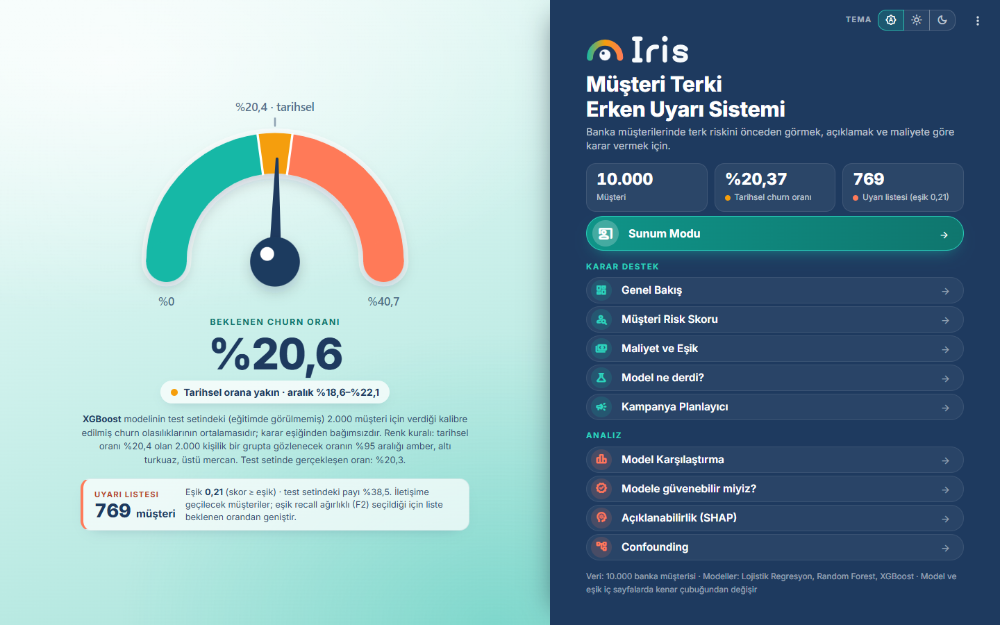
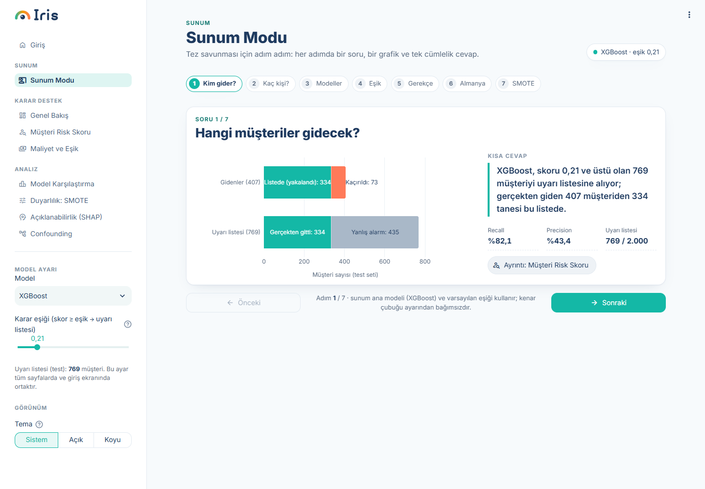
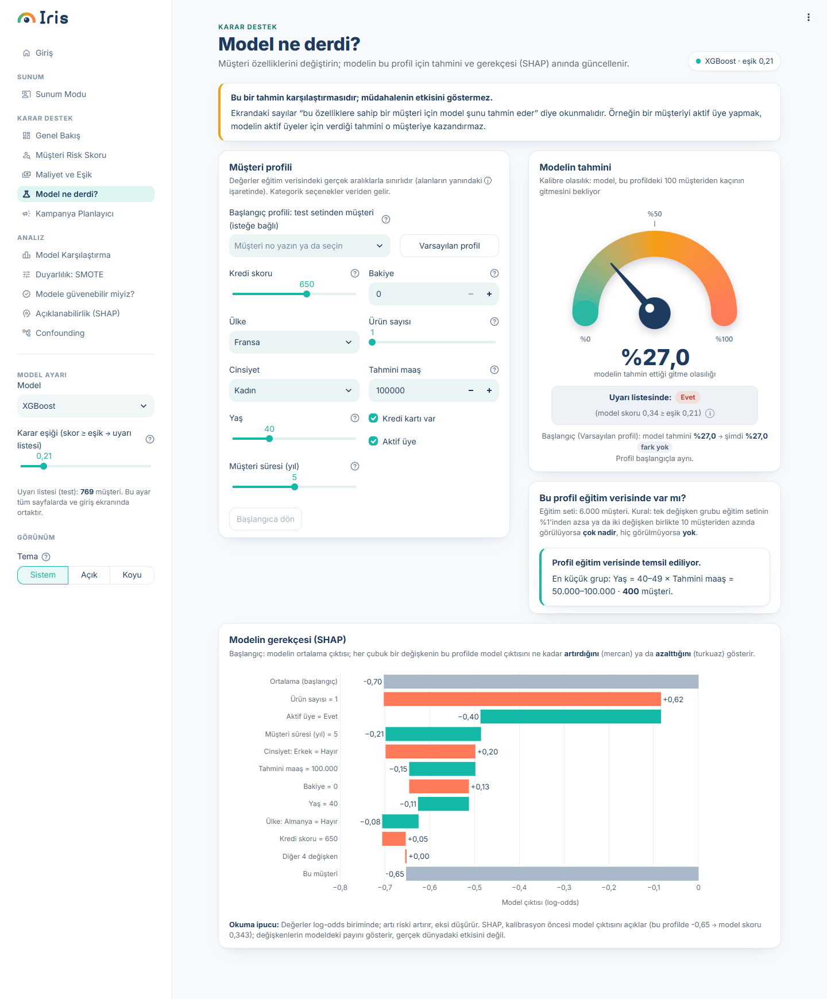
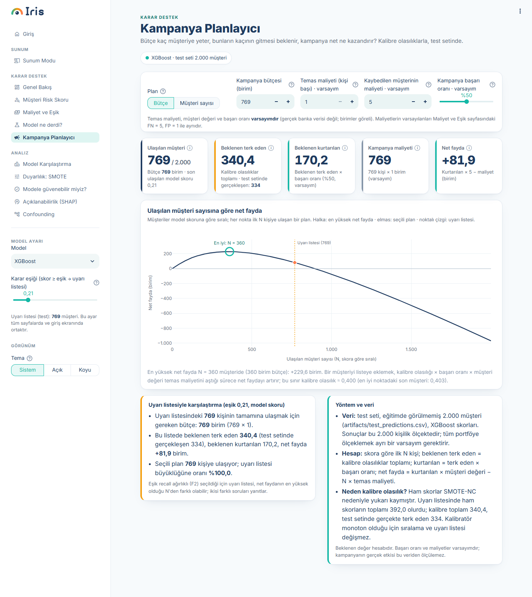
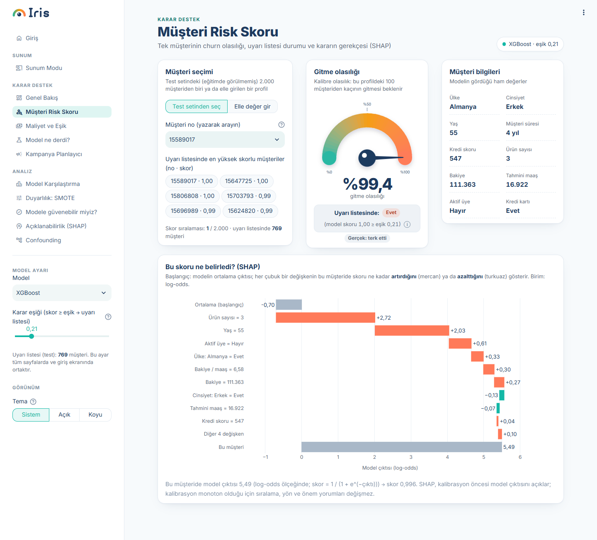
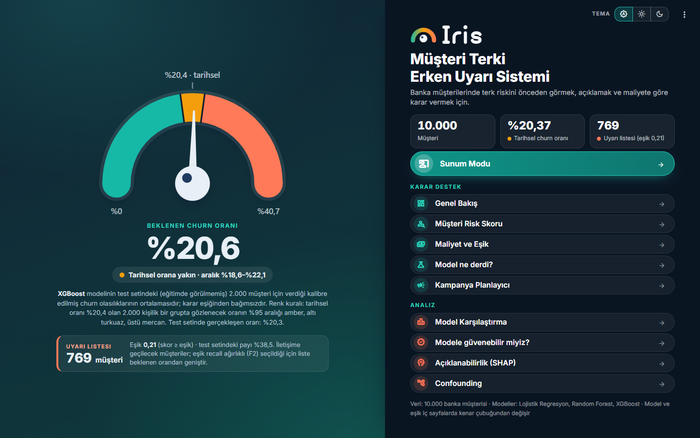

<p align="center">
  <picture>
    <source media="(prefers-color-scheme: dark)" srcset="logo/final/iris-logo-header-dark.png">
    
  </picture>
</p>

# Iris: Bank Customer Churn Early-Warning System

> **Türkçe özet.** Iris, bir bankanın hangi müşterilerinin ayrılma (churn) riski taşıdığını önceden
> gösteren, bu tahmini açıklayan ve maliyete göre karar vermeye yardım eden bir erken uyarı
> panelidir. 10.000 müşterilik Kaggle verisinde Lojistik Regresyon, Random Forest ve XGBoost
> karşılaştırılır; eşik maliyete duyarlı (F2) seçilir, modeller McNemar + Holm ile test edilir,
> olasılıklar kalibre edilir ve her tahmin SHAP ile açıklanır. Python + Streamlit ile yazılmıştır.
> Çanakkale Onsekiz Mart Üniversitesi İstatistik Bölümü bitirme projesi.

## Arkadaşın için hızlı başlangıç (Windows)

1. **Python 3.13'ü kur:** <https://www.python.org/downloads/> → Python 3.13 indir. Kurulumun ilk
   ekranında **"Add python.exe to PATH"** kutusunu işaretle.
2. **Projeyi indir:** GitHub'da repo sayfasında **Code → Download ZIP** (sonra ZIP'i bir klasöre
   çıkar) ya da **GitHub Desktop → File → Clone repository**.
3. **`calistir.bat` dosyasına çift tıkla.** İlk açılışta sanal ortamı kurar ve paketleri indirir
   (internet gerekir, birkaç dakika sürer). Hazır olunca tarayıcıda <http://localhost:8501> açılır.
   Sonraki açılışlarda kurulum atlanır, uygulama doğrudan başlar.
4. Kapatmak için siyah konsol penceresini kapat.

> Windows "Bilgisayarınız korundu" uyarısı verirse **Ek bilgi → Yine de çalıştır**'a tıkla.
> Kurulum bozulursa proje klasöründeki `.venv` klasörünü silip `calistir.bat`'ı yeniden çalıştır.

---

## Overview

Iris is an early-warning dashboard for retail-bank customer churn. It answers four practical
questions: *who is likely to leave, how many, why, and is it worth acting?* Three models (logistic
regression, random forest and XGBoost) are trained on 10,000 customers with SMOTE-NC applied only to
the training split. The decision threshold is chosen on a separate validation split to maximise F2
(recall-weighted), model differences are tested with McNemar's test and Holm correction, predicted
scores are calibrated (Platt scaling) so that "expected churn" is a real probability, and every
individual prediction is explained with TreeSHAP. A confounding analysis checks whether the high
churn rate in Germany is a country effect or a balance-structure effect.

Key results on the held-out test set (2,000 customers, 407 actual churners; source:
`artifacts/metrics.csv`, `artifacts/thresholds.json`, `artifacts/calibration.json`):

| | Value |
|---|---|
| Historical churn rate (full data, 10,000 customers) | **20.37%** |
| Default model / threshold | **XGBoost, score ≥ 0.21** (F2-optimal on validation) |
| Alert list size at that threshold | **769 of 2,000** customers |
| Churners caught | 334 of 407 → recall **82.1%**, precision **43.4%**, F2 **0.697** |
| XGBoost ROC-AUC / PR-AUC | **0.866 / 0.711** |
| Expected churn rate (mean calibrated probability, XGBoost) | **20.6%** (actual on test: 20.35%) |

| Model | F2-optimal threshold | Recall | Precision | F2 | ROC-AUC |
|---|---|---|---|---|---|
| Logistic Regression | 0.21 | 0.840 | 0.296 | 0.614 | 0.765 |
| Random Forest | 0.25 | 0.840 | 0.403 | 0.690 | 0.863 |
| XGBoost | 0.21 | 0.821 | 0.434 | 0.697 | 0.866 |

All three pairwise McNemar tests remain significant after Holm correction (`artifacts/mcnemar.csv`).

## Features

- **Cost-sensitive threshold (F2):** the alert threshold is tuned on the validation split to maximise
  F2, since a missed churner costs more than a false alarm. The *Cost & Threshold* page lets you set
  FN/FP costs (default 5:1, hypothetical units), shows validation and test cost curves and the
  Bayes threshold, and applies a new threshold app-wide with one click.
- **Statistical model comparison:** McNemar's test for the three model pairs with Holm correction,
  plus ROC/PR curves and a plain-language interpretation.
- **Confounding check:** Germany × has-balance cross-tabulation, chi-square test, stratified churn
  rates with Wilson CIs, and logistic regressions (statsmodels) showing how the Germany odds ratio
  changes after adjusting for balance, age, gender, activity and product count. Findings are
  associational, not causal.
- **SMOTE-NC:** oversampling inside an imbalanced-learn pipeline, training data only, with binary and
  count columns treated as categorical so no impossible values (e.g. 0.37 products) are synthesised.
  A sensitivity page compares results with and without SMOTE.
- **Probability calibration:** Platt (sigmoid) vs. isotonic chosen by 5-fold CV Brier score on the
  validation split; Brier score improves for all three models (XGBoost 0.1041 → 0.1011). Alert lists
  always use the raw score vs. the raw threshold; calibrated probabilities are used for display and
  expected-churn estimates.
- **Explainability (SHAP):** global importance, beeswarm and dependence plots, and per-customer
  waterfall charts with Turkish feature labels. TreeSHAP is computed with XGBoost's built-in
  `pred_contribs` (no `shap`/`numba` dependency; see `iris_shap.py`).
- **Presentation Mode:** a 7-step, question-by-question walkthrough for the thesis defence
  ("Who will leave?", "How many?", models, threshold, rationale, Germany, SMOTE).
- **Simulator ("Model ne derdi?"):** change a customer profile and see the model's prediction and SHAP
  explanation update instantly, with a rarity check that warns when the profile is poorly represented
  in the training data.
- **Campaign Planner:** given a budget, contact cost, customer value and success rate, estimates
  expected churners reached, customers saved and net benefit by number of customers contacted.
- **Light / dark theme**, Turkish number formatting, and a "Can we trust the model?" page.

## Screenshots

| Landing page | Presentation Mode |
|---|---|
|  |  |
| **Simulator** | **Campaign Planner** |
|  |  |
| **Customer risk score** | **Landing page (dark theme)** |
|  |  |

## Demo video

*Demo video: watch it under [Releases](../../releases) (link to be added).*

## Data

Dataset: **Bank Customer Churn Dataset** by Gaurav Topre on Kaggle:
<https://www.kaggle.com/datasets/gauravtopre/bank-customer-churn-dataset>
(10,000 rows, 12 columns: `customer_id`, `credit_score`, `country`, `gender`, `age`, `tenure`,
`balance`, `products_number`, `credit_card`, `active_member`, `estimated_salary`, `churn`).

The code expects the file at exactly this path (it is included in this repository):

```
data/Bank Customer Churn Prediction.csv
```

If the file is missing, download it from the Kaggle page above and place it there with this exact name.

## Installation and running

Tested with **Python 3.13.15** on Windows 11. Package versions are pinned in `requirements.txt`
(including `scipy==1.17.1`); the saved models in `artifacts/` were created with these versions.

**Easiest (Windows):** double-click `calistir.bat` (see the quick start above).

**Manual (PowerShell):**

```powershell
py -3.13 -m venv .venv
.\.venv\Scripts\python.exe -m pip install -r requirements.txt
.\.venv\Scripts\python.exe -m streamlit run app.py
```

The dashboard opens at <http://localhost:8501>. Trained models are already in `artifacts/`, so
training is optional. To reproduce everything from scratch:

```powershell
.\.venv\Scripts\python.exe train.py                 # models, thresholds, metrics, McNemar, SHAP (~1 min)
.\.venv\Scripts\python.exe calibrate.py             # probability calibration on the validation split
.\.venv\Scripts\python.exe smote_karsilastirma.py   # SMOTE sensitivity analysis
.\.venv\Scripts\python.exe smoke_test.py            # optional: runs every page headlessly
```

## Method summary

- `customer_id` is not a model input. One-hot encoding: `country` (reference France), `gender`
  (reference Female). Engineered features: `has_balance` and `balance_salary_ratio`.
- Stratified split (`random_state=42`): 60% train, 20% validation (threshold and calibration only),
  20% test (reporting only).
- Pipelines: `StandardScaler → SMOTENC(sampling_strategy=0.5) → model`; SMOTE runs only during
  fitting, so validation and test data are never resampled.
- Models: Logistic Regression, Random Forest (300 trees, depth 10), XGBoost (300 trees, depth 4,
  learning rate 0.05).

## Project structure

```
app.py                  Streamlit entry point (pages, theme, sidebar model/threshold)
sayfalar/               Dashboard pages (landing, presentation mode, overview, risk score,
                        cost & threshold, simulator, campaign planner, model comparison,
                        SMOTE sensitivity, model trust, SHAP, confounding)
iris_ui.py              Design system: light/dark theme, CSS, Plotly template, cards, gauges
iris_data.py            Data/artifact loading, calibration, Wilson CI, alert list, shared settings
iris_shap.py            TreeSHAP via XGBoost pred_contribs (no shap package)
iris_musteri.py         Customer profile, gauge and SHAP waterfall helpers
iris_karar.py           Rarity check and campaign calculations
analysis.py             Confounding analysis and cost-sensitive threshold functions
train.py                Training, thresholds, metrics, McNemar + Holm, SHAP → artifacts/
calibrate.py            Calibration check and calibrators → artifacts/calibration.*
smote_karsilastirma.py  SMOTE sensitivity analysis → artifacts/smote_karsilastirma.*
smoke_test.py           Automated check that analysis functions and all pages run
calistir.bat            One-click setup and launch for Windows
dashboard-baslat.bat    Launcher for an existing .venv (used by the desktop shortcut)
artifacts/              Trained models and results read by the app
data/                   Kaggle dataset (see "Data")
logo/                   Logo concepts and final logo/icon files (logo/final is used by the app)
docs/screenshots/       Screenshots used in this README
.streamlit/config.toml  Light/dark theme configuration
literatur/              Literature review (Turkish)
tasarim-taslak/         Design drafts, progress notes and video production scripts
tasarim-ornekleri/      Third-party dashboard examples used as design inspiration
backup/                 Earlier versions of the code
```

## Author

**Ahmet Berat Yarış**
Çanakkale Onsekiz Mart Üniversitesi, Department of Statistics, Graduation Project (Bitirme Projesi)

## License

TBD
